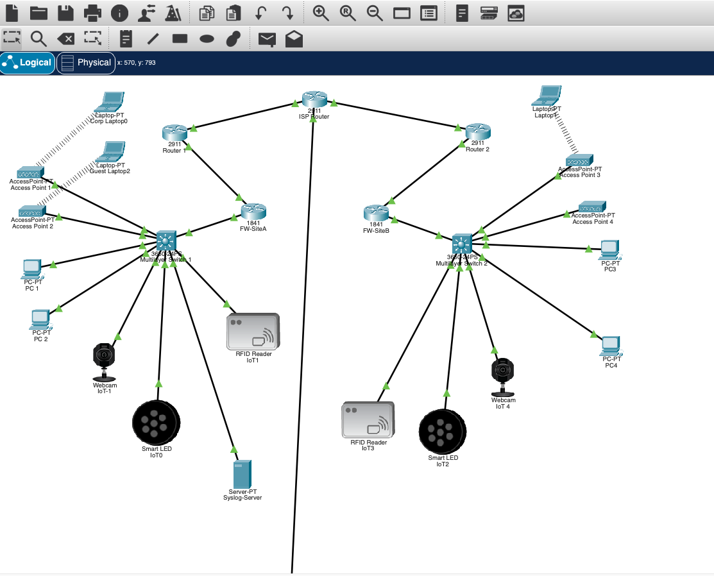
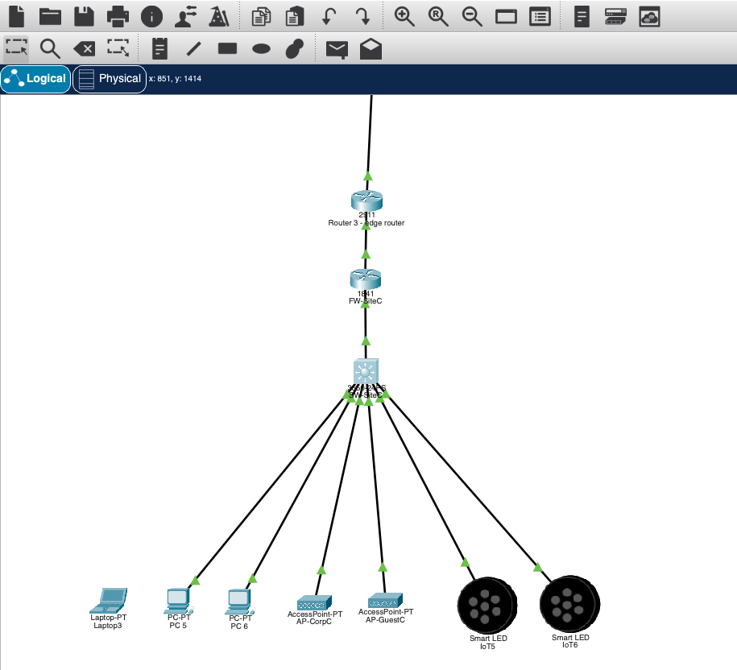
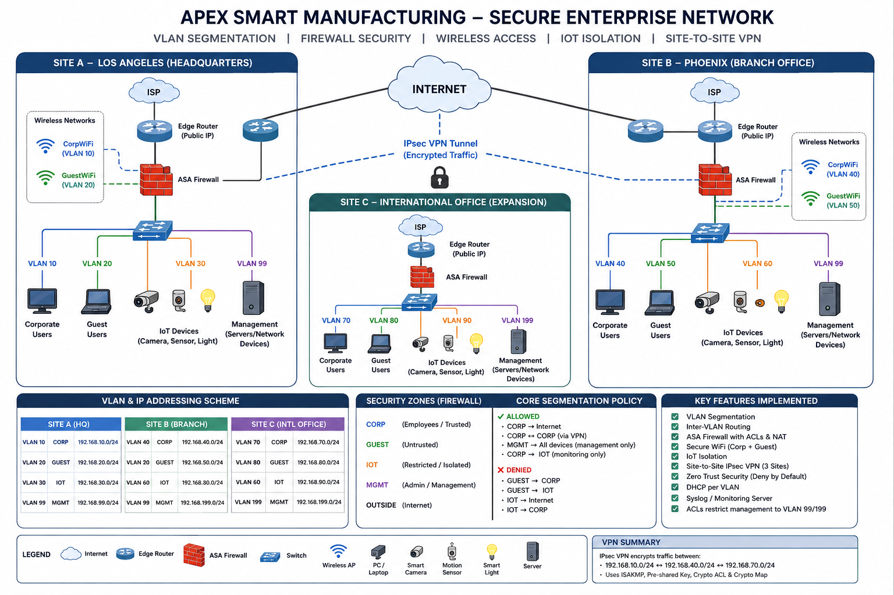
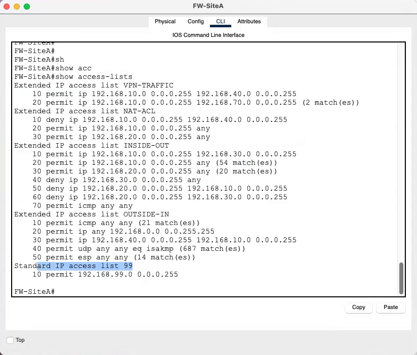
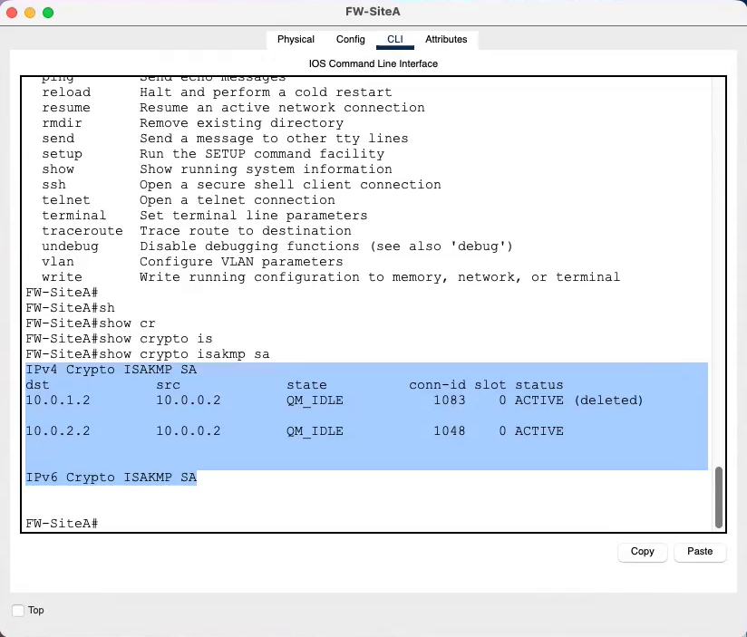
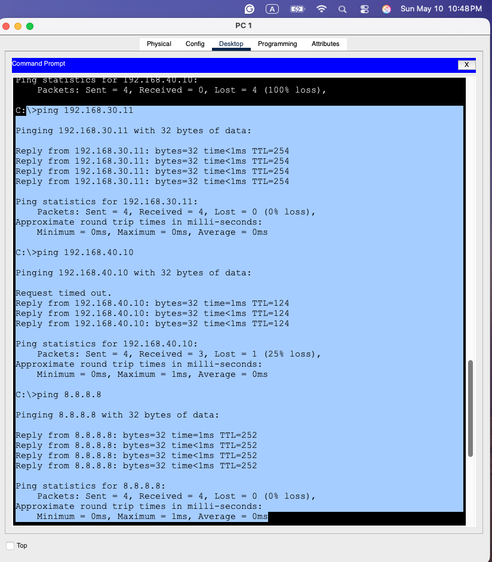
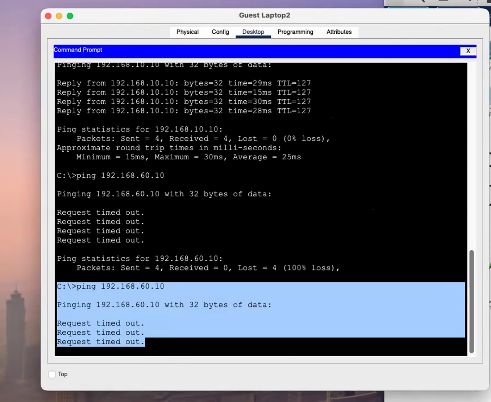

# Secure Smart Enterprise Network (Three-Site Packet Tracer Lab)

A Cisco Packet Tracer design for a fictional manufacturer, built as a graduate information assurance final (CYB555). The lab segments each site into Corporate, Guest, IoT, and Management VLANs, adds Corp and Guest wireless networks, places IoT devices in their own VLAN, and connects the sites with IPsec site-to-site VPNs. It covers the two required sites plus the optional third "international" site.

The evidence is a design report, screenshots, and stills from a 23-minute screen recording. Several security controls work as intended. One segmentation rule (Guest → Corporate) is shown **not** working in the final recording. The corrected report and this README document both outcomes and the fix.

> **Scope note.** "Apex Smart Manufacturing" and the guest-accesses-camera incident are instructor-provided scenarios. All addresses and devices are simulated.

## At a glance

| | |
|---|---|
| Context | CYB555 final project; screenshots dated 10 and 13 May 2026 |
| Environment | Cisco Packet Tracer (title bars reference a "Cisco Packet Tracer 9.0.0" save folder) |
| Sites | A (Los Angeles HQ), B (Phoenix branch), C (international expansion) |
| Strongest evidence | VLAN tables on all three switches; ISAKMP/IPsec SAs from FW-SiteA to both remote sites; ping matrix showing IoT reachable from Corp, Guest blocked from remote IoT, Internet reachable |
| Notable gaps | "ASA" firewalls are 1841 routers named FW-Site*; Guest → Corp ping succeeds in the recording; IoT → Internet block is reported but not shown |

## Business problem and lab context

The scenario company has guest Wi-Fi users probing internal systems, IoT devices that could be exposed to the Internet, and a need for encrypted site-to-site traffic. The assignment asked for VLAN-based security zones, ASA firewalls with NAT and ACLs, Corp and Guest WPA2 wireless, IoT isolation, an IPsec VPN between the Corporate VLANs, and default-deny segmentation. It also included an investigation task: a guest user reached an IoT camera at the branch, and the student must find and fix the cause.

[docs/architecture.md](docs/architecture.md) summarizes the requirements next to what was built. The assignment text is not republished.

## My contribution

This was individual work. The evidence shows:

- A three-site topology: 2911 edge routers, an ISP router, 1841 routers acting as site firewalls, 3650 multilayer switches, access points, PCs, laptops, and IoT devices (webcams, smart LEDs, RFID readers).
- VLANs 10/20/30/99 (A), 40/50/60/99 (B), and 70/80/90/99 (C), with inter-VLAN routing on the multilayer switches.
- IPsec from FW-SiteA to FW-SiteB and FW-SiteC, plus FW-SiteA ACLs for VPN traffic, NAT exemption, and inside/outside filtering.
- Syslog forwarding from Site A's multilayer switch to a Syslog server in the MGMT VLAN.
- A design report covering design, VPN, IoT risk, and segmentation, published here in a corrected version ([report](reports/apex-secure-enterprise-network-design-report.md)), plus a walkthrough recording (not published; see Limitations).

## Tools and technologies evidenced

- Cisco Packet Tracer; 2911 routers (edge and ISP), 1841 routers (FW-SiteA/B/C), 3650-24PS multilayer switches, AccessPoint-PT, Linksys WPC300N wireless client
- 802.1Q VLANs and switch virtual interfaces (SVIs)
- Static routing with default routes toward a simulated ISP; 8.8.8.8 is a loopback on the ISP router
- IOS IPsec: crypto map `VPN-MAP`, ACL `VPN-TRAFFIC`, peers 10.0.1.2 (Site B) and 10.0.2.2 (Site C)
- Extended ACLs `INSIDE-OUT`, `OUTSIDE-IN`, `NAT-ACL`; standard ACL `99` (MGMT subnet)
- WPA2-PSK SSIDs: CorpWiFi, GuestWiFi, CorpWiFi-B, GuestWiFi-B
- DHCP for wireless and IoT clients; Syslog (UDP 514) to 192.168.99.10

Not evidenced: Cisco ASA, security-level/zone configuration, IDS/IPS, SIEM, or a simulated attack.

## Architecture overview


*Sites A (left) and B (right). Each site: 2911 edge router → 1841 "FW-Site" router → 3650 multilayer switch → PCs, access points, IoT devices. The ISP 2911 sits between the sites, and the line leaving the bottom of the frame goes to Site C.*


*Site C (expansion): Router 3 (edge, 2911) → FW-SiteC (1841) → SW-SiteC (3650) with Corp/Guest access points, PCs, a laptop, and two smart LEDs.*

A summary diagram and addressing tables are in [docs/architecture.md](docs/architecture.md).


*Explanatory illustration only. The original file name indicates it was generated with ChatGPT; it is not implementation evidence. It labels the firewalls as ASAs and shows Site C MGMT as VLAN 199, while the lab uses 1841 routers and VLAN 99. It also assigns 192.168.199.0/24 to the MGMT networks of both Site B and Site C.*

## Implementation highlights

- **Zones per site.** SW-SiteA: CORP 10 (Gig1/0/1, 2, 6), GUEST 20 (Gig1/0/7), IOT 30 (Gig1/0/3–5), MGMT 99 (Gig1/0/23). Sites B and C follow the same pattern with VLANs 40/50/60 and 70/80/90.
- **Selective VPN.** `VPN-TRAFFIC` on FW-SiteA encrypts only CORP 192.168.10.0/24 to CORP 192.168.40.0/24 and 192.168.70.0/24. Guest and IoT subnets are not tunneled.
- **IoT egress block.** `INSIDE-OUT` sequence 40 denies 192.168.30.0/24 to any.
- **Management restriction.** Standard ACL `99` permits only 192.168.99.0/24 (its application, for example on VTY lines, is not shown).
- **Logging.** Site A's multilayer switch sends trap-level logs to 192.168.99.10; the Syslog server shows received link/line-protocol and configuration messages.


*Still from the walkthrough recording (about 21:00): FW-SiteA `show access-lists` with VPN-TRAFFIC, NAT-ACL, INSIDE-OUT, OUTSIDE-IN, and standard ACL 99. INSIDE-OUT permits 192.168.20.0/24 to any at sequence 30, before the Guest denies at 50 and 60 (see validation).*


*Still from the recording (about 14:35): FW-SiteA (10.0.0.2) has ISAKMP SAs in QM_IDLE with Site B (10.0.1.2) and Site C (10.0.2.2). The Site B entry also shows an older SA marked "(deleted)".*


*PC1 (Site A Corp): IoT host 192.168.30.11 replies (Corp → IoT monitoring allowed). Site B Corp host 192.168.40.10 replies after one timeout through the VPN, after an earlier attempt shown at the top with 100% loss. 8.8.8.8 replies (Corp → Internet).*

## Validation summary

| Area | Status |
|---|---|
| VLANs at all three sites | Demonstrated |
| Corp → Internet, Corp → IoT, Corp ↔ Corp over VPN (A↔B, A↔C) | Demonstrated |
| IPsec SAs from Site A to Sites B and C | Demonstrated |
| Guest → Internet; Guest → remote-site IoT blocked | Demonstrated |
| Guest → Corp blocked | **Failed in recording**: Guest Laptop2 → 192.168.10.10 gets 4/4 replies |
| Guest → same-site IoT blocked (the investigation scenario) | Not shown |
| IoT → Internet blocked | Configured (ACL); test reported only |
| Wireless (WPA2, SSID → VLAN mapping) | Partial: SSIDs, WPA2-PSK, and one Corp DHCP lease shown |
| ASA firewalls | Not implemented (1841 routers used) |

Full table: [docs/validation.md](docs/validation.md).


*Still from the recording (about 19:00): Guest Laptop2 gets replies from 192.168.10.10 (Site A CORP) with TTL 127, while Site B IoT host 192.168.60.10 times out. The guest laptop's own address is not visible in the frames reviewed.*

## Investigation task: guest reached an IoT camera

I traced the guest access to missing or misordered deny rules and added Guest → IoT and Guest → Corporate denies on FW-SiteA. The final capture shows two problems remaining. First, the denies sit after a broader `permit ip 192.168.20.0 0.0.0.255 any`, so under first-match processing they never take effect. Second, inter-VLAN traffic at Site A is routed on the multilayer switch and never reaches FW-SiteA. Both fit the Guest → Corp ping that succeeds in the recording. The [corrected report](reports/apex-secure-enterprise-network-design-report.md#investigation-guest-access-to-an-iot-camera) gives the root cause and the required fix (reorder the ACL and filter on the switch SVIs). The fix has not yet been re-tested. The full analysis is in [docs/validation.md](docs/validation.md#investigation-task-analysis).

## Limitations and missing artifacts

- **Firewall platform.** The assignment called for Cisco ASA firewalls. The lab uses 1841 routers running IOS ACLs as site firewalls (the original report said "ASA"; the corrected report fixes this).
- **Inter-VLAN routing method.** Routing between VLANs is done by SVIs on the multilayer switches, which the assignment allowed. The original report said router-on-a-stick; the corrected report fixes this.
- **No running configurations.** NAT statements, crypto map/ISAKMP policy, the pre-shared key, WPA2 passphrases, and the interface bindings of ACLs are not visible.
- **The Packet Tracer file is not published** because it contains the VPN pre-shared keys and Wi-Fi passphrases (see [labs/README.md](labs/README.md)).
- **Recording not published.** The 23:38 screen recording (and its separate audio file) were sampled visually at one frame per minute plus targeted frames. The audio was not reviewed. The video also shows the local file path and desktop. Stills used here are cropped to the device window.
- **Only Site A firewall evidence.** No ACL, crypto, or routing output was captured from FW-SiteB or FW-SiteC.
- **IoT device set.** The assignment listed a camera, motion sensor, and smart light per site. The topology shows webcams, smart LEDs, and RFID readers; no motion sensor is visible.
- **Phase 10 extras.** DHCP per VLAN is partly shown (Corp wireless, IoT5). A third site and syslog are shown. "Restrict VPN to specific VLANs" is reflected in `VPN-TRAFFIC`. Attack-traffic simulation is not shown.

## Lessons learned

**From the report** (section numbers refer to the corrected report):
- IoT devices bring weak default credentials, slow patching, and limited built-in security. Isolating them in their own VLAN limits the damage a compromised device can do (§3).
- ACL order matters: a deny placed after a broader permit never takes effect, which is the root cause of the guest-to-Corporate gap (§4).
- Encrypting only Corp-to-Corp traffic keeps the tunnel's scope narrow (§2).


## Reviewing this repository

1. Read [docs/validation.md](docs/validation.md) for what worked, what failed, and what is only reported.
2. Use [docs/evidence-index.md](docs/evidence-index.md) to trace each claim to a screenshot, recording timestamp, or report page.
3. The corrected report is in `reports/`; its last section lists every correction and the evidence behind it.
4. The Packet Tracer simulation is available on request; see [labs/README.md](labs/README.md).

## Repository contents

```
README.md
docs/
  architecture.md      requirements vs. built design, addressing, device roles
  implementation.md    transcribed ACL, routing, VLAN, and crypto output
  validation.md        test table, investigation-task analysis
  evidence-index.md    claim → file / timestamp / page; excluded originals
reports/               design report (corrected version)
labs/                  note on the Packet Tracer file (not published)
assets/screenshots/    selected, renamed, redacted screenshots and recording stills
```

## Use and licensing

No license is applied. The assignment scenario belongs to the course instructor. The overview illustration was AI-generated, and its reuse terms have not been reviewed. Contact the author before reusing any material.
