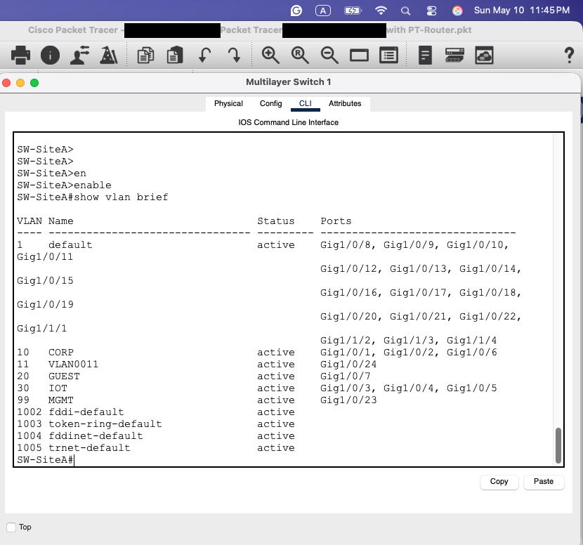
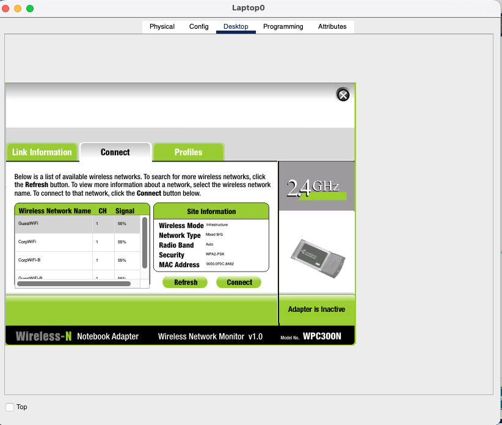
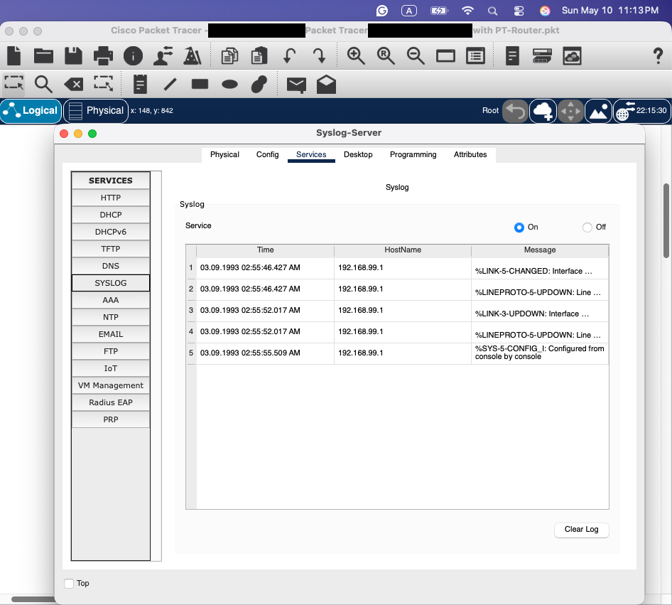

# Secure Smart Enterprise Network: Three-Site Zero-Trust Design

I designed and built a segmented three-site enterprise network in Cisco Packet Tracer for a smart-manufacturing company. Each site is split into Corporate, Guest, IoT, and Management security zones, with WPA2 Corp and Guest Wi-Fi and IoT isolated in its own VLAN. IOS access lists enforce the zone policy, and IPsec VPNs connect headquarters to a branch office and an international office. I validated the design with a reachability test matrix and investigated a guest-to-IoT access incident down to its root cause.

**Tools:** Cisco Packet Tracer 9.0, Cisco IOS


## Highlights

- **Three sites, four zones each.** CORP, GUEST, IOT, and MGMT VLANs at Los Angeles HQ, the Phoenix branch, and an international expansion site, for 12 VLANs in total.
- **Layer 3 switching.** Inter-VLAN routing on Cisco 3650 multilayer switches (SVIs), with point-to-point links to each site's firewall.
- **Firewall policy in IOS ACLs.** Separate lists for inside-to-outside, outside-to-inside, NAT, VPN interesting traffic, and management access.
- **Multi-site IPsec.** Encrypted tunnels from HQ to both remote sites, scoped to Corporate subnets only.
- **IoT isolation.** A dedicated VLAN with an explicit deny to the Internet, while Corporate keeps monitoring access.
- **Secure wireless.** CorpWiFi and GuestWiFi SSIDs at each site using WPA2-PSK, mapped into the correct zones.
- **Centralized logging.** Syslog from the HQ multilayer switch to a server in the management VLAN.

## Architecture

| Zone | Site A – Los Angeles | Site B – Phoenix | Site C – International |
|---|---|---|---|
| CORP | VLAN 10 · 192.168.10.0/24 | VLAN 40 · 192.168.40.0/24 | VLAN 70 · 192.168.70.0/24 |
| GUEST | VLAN 20 · 192.168.20.0/24 | VLAN 50 · 192.168.50.0/24 | VLAN 80 · 192.168.80.0/24 |
| IOT | VLAN 30 · 192.168.30.0/24 | VLAN 60 · 192.168.60.0/24 | VLAN 90 · 192.168.90.0/24 |
| MGMT | VLAN 99 · 192.168.99.0/24 | VLAN 99 | VLAN 99 · 192.168.199.0/24 |

Every site uses the same stack:

```
Hosts / APs / IoT ── 3650 multilayer switch (SVIs) ── 1841 site firewall (IOS ACLs, IPsec) ── 2911 edge router ── ISP
```


Routing, addressing, and the policy matrix are in [docs/architecture.md](docs/architecture.md).

## Security Policy

| Flow | Policy | Enforcement |
|---|---|---|
| CORP → Internet | Allow | `INSIDE-OUT` |
| CORP ↔ CORP (other sites) | Allow, encrypted | `VPN-TRAFFIC` + crypto map `VPN-MAP` |
| CORP → IOT | Allow (monitoring) | `INSIDE-OUT` |
| MGMT → devices | Allow | Standard ACL 99 |
| IOT → Internet | Deny | `INSIDE-OUT` |
| GUEST → Internet | Allow | `INSIDE-OUT` |
| GUEST → CORP / IOT | Deny | `INSIDE-OUT` (see investigation) |


## Implementation

**IPsec to both remote sites.** FW-SiteA holds ISAKMP SAs with the Site B and Site C firewalls. The IPsec counters show traffic encrypted and decrypted in both directions: 4/4 with Site B and 18/6 with Site C.


**Zones on every switch.** CORP, GUEST, IOT, and MGMT VLANs with assigned access ports at each site.



**Wireless.** Four WPA2-PSK SSIDs; Corporate laptops receive VLAN 10 addressing through DHCP.



**Logging.** The HQ switch sends its logs to `192.168.99.10` over UDP 514, and the syslog server records them.



Device-by-device output is in [docs/implementation.md](docs/implementation.md).

## Validation

| Test | Expected | Result |
|---|---|---|
| CORP Site A ↔ Site B over VPN | Pass | ✅ Replies (TTL 124) after tunnel negotiation |
| CORP Site A ↔ Site C over VPN | Pass | ✅ 4/4 after tunnel negotiation |
| CORP → Internet | Pass | ✅ 4/4 |
| CORP → IoT (monitoring) | Pass | ✅ 4/4 |
| GUEST → Internet | Pass | ✅ 4/4 |
| GUEST → remote-site IoT | Fail | ✅ Blocked (100% loss) |
| GUEST → CORP at the same site | Fail | ❌ Reachable; root cause identified below |


Full matrix and evidence: [docs/validation.md](docs/validation.md).

## Incident Investigation: Guest Reached an IoT Camera

**Finding.** Guest devices could reach internal hosts at their own site.

**Root cause.** I traced it to two issues:

1. **ACL ordering.** The Guest deny entries in `INSIDE-OUT` sat after a broader `permit 192.168.20.0 any`. With first-match processing, the denies never fired.
2. **Routing path.** Inter-VLAN traffic at each site is routed on the multilayer switch's SVIs, so Guest-to-Corp traffic never reaches the firewall where that ACL is applied.


**Remediation.**

- Move the Guest denies above the permit.
- Apply inbound ACLs on the Guest and IoT SVIs (or VLAN access maps), so the zone policy is enforced where the traffic is routed.
- Re-test Guest → Corp and Guest → IoT at each site.

Full analysis: the [design report](reports/apex-secure-enterprise-network-design-report.md#investigation-guest-access-to-an-iot-camera) and [docs/validation.md](docs/validation.md#investigation-task-analysis).

## Key Takeaways

- **Filter where you route.** With Layer 3 switching, the edge firewall never sees intra-site traffic. Segmentation has to be enforced on the SVIs too.
- **ACL order is policy.** A correct deny placed after a broad permit is the same as having no deny. Every "must fail" rule needs its own failing test.
- **Reachability is not proof of encryption.** The IPsec encaps/decaps counters, not the pings, are what show traffic actually went through the tunnel.
- **IoT needs its own zone.** Default credentials and slow patching make IoT a likely foothold, and isolating it limits the blast radius.

## Next Steps

- Apply and re-test the Guest remediation: reorder the ACL and add SVI ACLs.
- Tighten the default-deny posture by removing the broad `permit icmp any any` and the 192.168.0.0/16 inbound entries.
- Add IDS/IPS at each site firewall and extend syslog to every firewall and switch.
- Move the site firewalls to Cisco ASA with zone-based security levels.

## Repository Guide

| Path | Contents |
|---|---|
| [`reports/`](reports/) | [Network design report](reports/apex-secure-enterprise-network-design-report.md) |
| [`docs/architecture.md`](docs/architecture.md) | Sites, zones, addressing, routing, policy matrix |
| [`docs/implementation.md`](docs/implementation.md) | VLAN, routing, ACL, IPsec, wireless, and syslog output |
| [`docs/validation.md`](docs/validation.md) | Test matrix and investigation analysis |
| [`docs/evidence-index.md`](docs/evidence-index.md) | Every claim mapped to its screenshot or recording timestamp |
| [`labs/`](labs/) | Packet Tracer simulation (available on request) |
| [Overview illustration](assets/screenshots/illustration-ai-generated-network-overview.png) | Simplified conceptual overview (AI-generated) |

---

© 2026 Ghazal Mahdian. Company names and the incident scenario are fictional.
